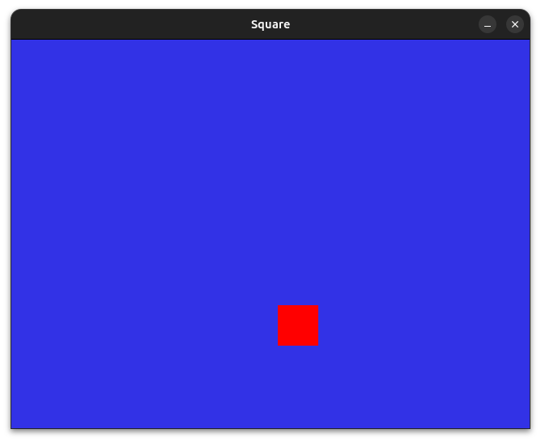
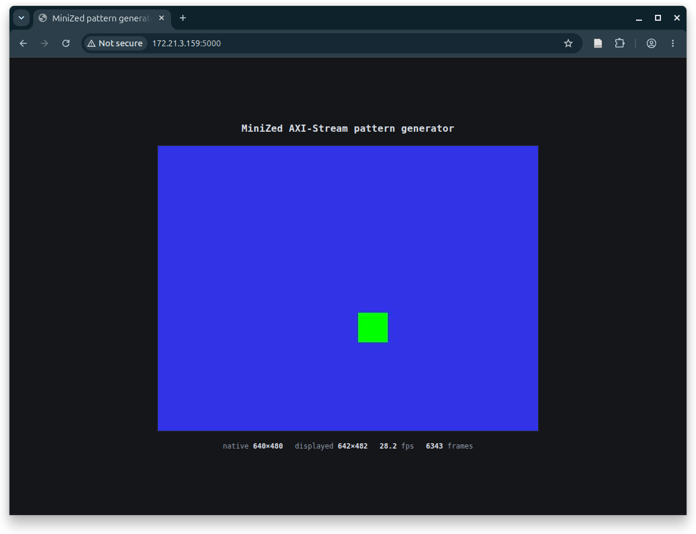

# axi4s_video

[Español](#español) · [English](#english)

---

## Español

Este proyecto es un generador de patrón de video con interfaz **AXI4-Stream Video** escrito en Verilog,
pensado como ejemplo práctico del protocolo AXIS y de sus convenciones de video de
Xilinx (`tuser` = inicio de cuadro, `tlast` = fin de línea).

El núcleo genera un cuadrado de color que rebota sobre un fondo azul a 640x480
(RGB 8 bits por canal en un `tdata` de 32 bits). El proyecto cubre todo el
recorrido: simulación, verificación del protocolo y ejecución real en una placa
**MiniZed (Zynq-7000)** con Linux.

```
m_axis (patrón) --AXI4-Stream--> AXI VDMA (S2MM) --> DDR --> /dev/video0 --> app web
```

### Estructura

| Carpeta | Contenido |
|---|---|
| `rtl/` | `m_axis.v` (maestro AXIS, generador de patrón con skid buffer), `s_axis.v` (esclavo AXIS a señales tipo VGA), `top.v` |
| `sim/` | `main.cpp`: simulación con Verilator + SDL2 que muestra el video en una ventana · `top_tb.v`: testbench Icarus que verifica `tvalid/tready`, `tlast` y `tuser` |
| `sw/kernel-module/` | Driver V4L2 mínimo (`vpatt-v4l2`) que expone el stream como `/dev/video0` (640x480 XBGR32) |
| `sw/app/` | Visor web en Flask que transmite el video desde la placa |
| `sw/system-bsp.dtsi` | Device tree para el diseño en la MiniZed |
| `doc/` | Guía práctica de AXI4-Stream y AXI4-Stream Video (`report.pdf`) |
| `img/` | Capturas de la simulación y de la placa |

### Uso

Requisitos: `verilator`, `iverilog`, `gtkwave`, `libsdl2-dev`.

```sh
make          # compila la simulación Verilator + SDL
make run      # ejecuta la simulación (Q para salir)
make sim-iv   # testbench Icarus: comprobación del protocolo AXIS-Video
make wave     # abre las formas de onda en GTKWave
make lint     # lint con Verilator
make clean
```

### Driver de video (Linux)

`vpatt-v4l2` es un driver V4L2 (Video4Linux2) mínimo que hace que la placa vea el
generador como si fuera una cámara:

- Usa el AXI VDMA (vía `dmaengine`) para copiar cada cuadro del stream a memoria
  DDR, en buffers contiguos (CMA).
- Expone el video como `/dev/video0`, con formato fijo **640x480 XBGR32** (`XR24`,
  4 bytes por píxel).
- Cualquier programa V4L2 puede leerlo (OpenCV, `v4l2-ctl`, la app web de `sw/app/`).

```sh
cd sw/kernel-module && make      # compilar (en la placa o con compilación cruzada)
sudo insmod vpatt-v4l2.ko        # cargar  -> aparece /dev/video0
sudo python3 sw/app/app.py       # visor web en http://<ip-de-la-placa>:5000
```

El device tree necesario está en `sw/system-bsp.dtsi`; los requisitos del kernel,
en [sw/kernel-module/README.md](sw/kernel-module/README.md).

### Capturas

| Simulación (Verilator + SDL) | MiniZed (visor web) |
|---|---|
|  |  |

### Licencia

GPL-2.0 — ver [LICENSE](LICENSE).

---

## English

This project is a video pattern generator with an **AXI4-Stream Video** interface written in
Verilog, intended as a hands-on example of the AXIS protocol and the Xilinx video
conventions (`tuser` = start of frame, `tlast` = end of line).

The core draws a colour square bouncing over a blue background at 640x480
(8-bit RGB per channel in a 32-bit `tdata`). The project covers the whole path:
simulation, protocol verification and running on real hardware, a
**MiniZed (Zynq-7000)** board running Linux.

```
m_axis (pattern) --AXI4-Stream--> AXI VDMA (S2MM) --> DDR --> /dev/video0 --> web app
```

### Layout

| Folder | Contents |
|---|---|
| `rtl/` | `m_axis.v` (AXIS master, pattern generator with skid buffer), `s_axis.v` (AXIS slave to VGA-style signals), `top.v` |
| `sim/` | `main.cpp`: Verilator + SDL2 simulation that shows the video in a window · `top_tb.v`: Icarus testbench that checks `tvalid/tready`, `tlast` and `tuser` |
| `sw/kernel-module/` | Minimal V4L2 driver (`vpatt-v4l2`) exposing the stream as `/dev/video0` (640x480 XBGR32) |
| `sw/app/` | Flask web viewer that streams the video from the board |
| `sw/system-bsp.dtsi` | Device tree for the MiniZed design |
| `doc/` | Practical guide to AXI4-Stream and AXI4-Stream Video (`report.pdf`) |
| `img/` | Simulation and board screenshots |

### Usage

Requirements: `verilator`, `iverilog`, `gtkwave`, `libsdl2-dev`.

```sh
make          # build the Verilator + SDL simulation
make run      # run the simulation (press Q to quit)
make sim-iv   # Icarus testbench: AXIS-Video protocol check
make wave     # open the waveforms in GTKWave
make lint     # Verilator lint
make clean
```

### Video driver (Linux)

`vpatt-v4l2` is a minimal V4L2 (Video4Linux2) driver that makes the board see the
generator as if it were a camera:

- It uses the AXI VDMA (through `dmaengine`) to copy each frame of the stream
  into DDR memory, in contiguous (CMA) buffers.
- It exposes the video as `/dev/video0`, with a fixed **640x480 XBGR32** format
  (`XR24`, 4 bytes per pixel).
- Any V4L2 program can read it (OpenCV, `v4l2-ctl`, the web app in `sw/app/`).

```sh
cd sw/kernel-module && make      # build (on the board or cross-compiled)
sudo insmod vpatt-v4l2.ko        # load  -> /dev/video0 appears
sudo python3 sw/app/app.py       # web viewer at http://<board-ip>:5000
```

The required device tree is in `sw/system-bsp.dtsi`; the kernel requirements are
in [sw/kernel-module/README.md](sw/kernel-module/README.md).

### Screenshots

| Simulation (Verilator + SDL) | MiniZed (web viewer) |
|---|---|
|  |  |

### License

GPL-2.0 — see [LICENSE](LICENSE).

---

Author: Yosel de Jesús Balibrea Lastre
